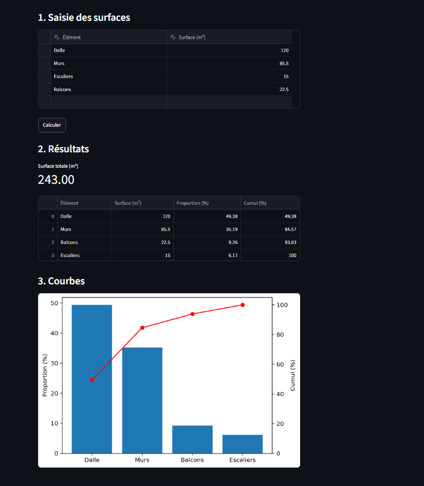

# Calculateur de proportions de surfaces

Application web qui calcule la proportion de chaque surface par rapport au
total et trace les courbes correspondantes (proportion et cumul).

Projet inspiré d'un stage en bureau d'études de génie civil.
Les données utilisées sont fictives.

## Technologies
Python, Streamlit, Pandas, Matplotlib

## Installation
    python -m venv venv
    venv\Scripts\activate
    pip install -r requirements.txt
    streamlit run app.py

## Aperçu
